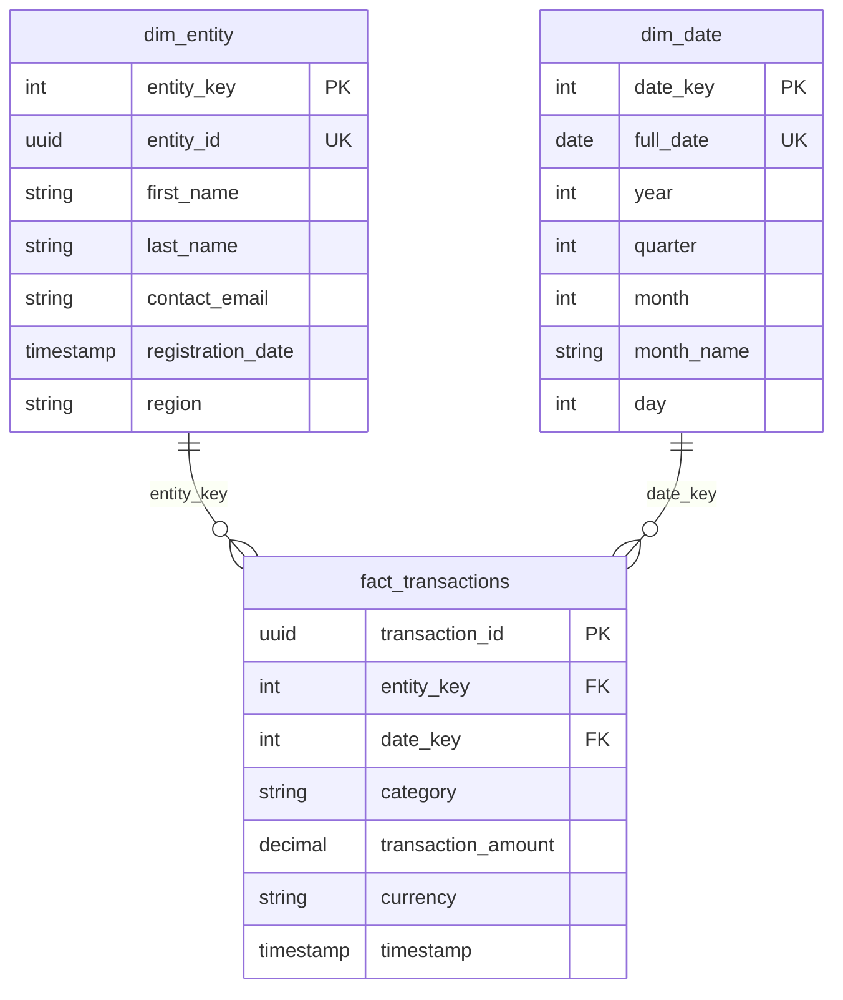

# Local Medallion ELT Pipeline: Python + Pydantic + DuckDB

A zero-infrastructure data pipeline implementing the **Bronze -> Silver -> Gold** medallion
architecture with a **star schema** in the Gold layer. Everything runs locally; the core
requirements are implemented first, with every optional bonus item on top.

```bash
pip install -r requirements.txt
python -m src.pipeline --generate     # data -> validate (DLQ) -> Bronze -> Silver -> Gold -> queries -> DQ report
pytest                                # 97 tests
```

## 1. Setup

Requires Python >= 3.10.

```bash
python -m venv .venv
source .venv/bin/activate        # Windows: .venv\Scripts\activate
pip install -r requirements.txt
```

`requirements.txt`: `duckdb>=0.9.0`, `pydantic[email]>=2.0.0` (the `email` extra installs
`email-validator`, needed by `EmailStr`), `pytest>=7.0.0`.

## 2. Data generation

```bash
python -m src.generate_data                 # 1000 entities, 5000 transactions, seed 42
python -m src.generate_data --entities 2000 --transactions 20000 --seed 7
```

Writes `data/raw/entities.csv` and `data/raw/transactions.json`. Planted issues:

| Source | Issue | Amount |
| --- | --- | --- |
| entities | exact duplicate records | 6 per 100 (brief requires >= 5) |
| entities | malformed e-mails (`john.example.com`, `john@`, `@example.com`, `john.example`) | 6 per 100 (>= 5), on *different* records from the duplicates |
| entities | messy region casing / whitespace (`north`, `SOUTH`, ` East `): valid, cleaned in Silver | ~60% |
| transactions | negative amount / null **or missing** `entity_id` / invalid currency | ~2% each |
| transactions | well-formed but unknown `entity_id` (orphans) | ~1.5% (+ those of rejected entities) |

Timestamps cover the last 90 days up to *now*, so the "current calendar month" query always has data.

## 3. Pipeline execution

```bash
python -m src.pipeline                    # full refresh from data/raw
python -m src.pipeline --generate         # regenerate mock data first
python -m src.pipeline --mode incremental # process only files not seen before
python -m src.pipeline --log-format json  # structured logs
python -m src.pipeline --strict           # exit 1 if a data-quality ERROR check fails (CI-friendly)
```

Outputs: `warehouse.duckdb`, DLQ files in `data/dlq/`, one CSV per query plus `run_summary.json` in
`data/output/`, and row counts, query results and the data-quality report on the console.
All paths are configurable (`--raw-dir --dlq-dir --output-dir --db-path`, or env vars
`PIPELINE_DATA_DIR`, `PIPELINE_RAW_DIR`, `PIPELINE_DLQ_DIR`, `PIPELINE_OUTPUT_DIR`, `PIPELINE_DB_PATH`).

Explore the result: `python -c "import duckdb; duckdb.connect('warehouse.duckdb').sql('SELECT * FROM dq_report').show()"`

### Incremental processing demo

```bash
python -m src.pipeline --generate --mode incremental      # batch 1: loads 2 files
python -m src.pipeline --mode incremental                 # nothing new -> skipped, warehouse untouched
python -m src.generate_data --suffix _batch2 --entities 200 --transactions 1000 --seed 99 \
       --include-existing-entities                        # a later batch lands in data/raw
python -m src.pipeline --mode incremental                 # loads ONLY the new files
python -m src.pipeline --mode full                        # rebuild from scratch: identical result
```

> `--mode full` (the default) resets the warehouse, so it is always safe to re-run. Use
> `--mode incremental` only when you are *adding* files; regenerating `entities.csv` with different
> content and running incrementally would be treated as a new batch.

## 4. Testing

```bash
pytest
```

**97 tests** (~8 s), grouped by what they protect:

| File | What it verifies |
| --- | --- |
| `test_contracts.py` | The validation boundary: negative/zero/NaN amount, invalid e-mail (4 spec examples + more), null **and** missing `entity_id`, invalid UUID, bad currency, blank names, missing fields, and that contracts do *not* mutate values |
| `test_ingestion.py` | DLQ routing: one bad record never stops the run; DLQ keeps the original payload + error; DLQ files written |
| `test_generator.py` | >= 5 duplicates and >= 5 malformed e-mails per 100, on separate records; every planted transaction issue; reproducible by seed |
| `test_pipeline.py` | End-to-end: nothing invalid reaches Bronze, Silver de-duplicates/standardises, star-schema referential integrity, idempotent re-runs |
| `test_queries.py` | Every analytical query against **hand-computed answers** (e.g. Q2 must average per-entity averages, not transactions; Q1 must exclude last month) |
| `test_incremental.py` | Re-run is a no-op; a new batch adds only new rows; **incremental == full rebuild**; stable surrogate keys; late-arriving entities; crash mid-transform rolls back and the next run recovers |
| `test_quality.py` | DQ checks pass on clean data *and* fail on injected corruption; warnings vs errors; DLQ circuit breaker |
| `test_logging_and_cli.py` | JSON logs, env-var configuration, CLI exit codes (`--strict`) |

I also mutation-checked the suite: deliberately breaking Q1's month filter, Q2's averaging, the
late-orphan resolution and the de-duplication order each made tests fail.
Verified on the latest DuckDB/Pydantic **and** on DuckDB 0.10.0 / Pydantic 2.5.3 / pytest 7.4.4
(DuckDB 0.9.x has no prebuilt wheel for the Python 3.12 I tested on, so the stated `>=0.9.0` floor itself is untested; I avoided version-specific SQL features, e.g. a recursive CTE instead of `generate_series`, to keep it portable).

## 5. Architecture

```
Raw CSV / JSON  (landed files = batches, identified by content hash)
      |
      v
Python Ingestion            src/ingestion.py
      |
      v
Pydantic Validation         src/contracts.py
      |
      +------ Invalid ------> DLQ  (data/dlq/invalid_<file>.json: original record + error + source row)
      |
      v
Bronze   (bronze_entities, bronze_transactions, etl_batches ledger)   sql/00_bronze_ddl.sql
      |
      v
Silver   (silver_entities, silver_transactions, silver_orphan_transactions)   sql/01_silver.sql
      |
      v
Gold Star Schema (dim_entity, dim_date, fact_transactions)            sql/02_gold.sql
      |
      v
Analytical SQL (sql/queries/*.sql)  +  Data-quality report (dq_report)
```



```
src/    config.py  contracts.py  generate_data.py  ingestion.py  warehouse.py  quality.py
        logging_config.py  pipeline.py
sql/    00_bronze_ddl.sql  01_silver.sql  02_gold.sql  queries/q1 ... q6
tests/  8 files (see above)
docs/   cloud_scaling.md   (cloud architecture diagram + discussion)
Dockerfile  .dockerignore  requirements.txt  pytest.ini
```

**Layer behaviour**
* **Bronze**: only contract-valid rows, values as received (duplicates and messy casing kept), plus lineage
  (`_source_file`, `_source_row`, `_batch_id`, `_ingested_at`). Invalid rows never enter.
* **Silver**: entities de-duplicated with `ROW_NUMBER() OVER (PARTITION BY entity_id ...)` (first-received wins);
  names trimmed, e-mail lower-cased, region trimmed/space-collapsed/upper-cased. Transactions de-duplicated on
  `transaction_id`, amounts `DECIMAL(18,2)`, `transaction_date` derived. Only transactions whose entity exists are
  conformed; the rest wait in `silver_orphan_transactions` and are **re-homed automatically** if their entity arrives later.
* **Gold**: `dim_entity` (stable surrogate `entity_key`), `dim_date` (contiguous calendar, `date_key` = YYYYMMDD),
  `fact_transactions` with PK/FK constraints to both dimensions.

### Analytical queries (`sql/queries/`)

| File | Question |
| --- | --- |
| `q1_monthly_revenue_by_category` | **(required)** total amount per category, current calendar month |
| `q2_top_regions_avg_per_entity` | **(required)** top 5 regions by average of per-entity average amounts |
| `q1b_...`, `q2b_...` | the same two questions split by currency (no mixed-currency sums) |
| `q3_monthly_revenue_trend_mom` | month-over-month growth per currency (`LAG`) |
| `q4_top3_categories_per_region` | top 3 categories per region by volume (`ROW_NUMBER`) |
| `q5_top10_entities_by_spend_usd` | Pareto: spend share + cumulative share (`RANK`, running `SUM`) |
| `q6_rolling_7day_revenue_usd` | daily revenue with a 7-day moving average (window frame) |

## 6. Design decisions

* **Pydantic**: declarative, typed contracts at the boundary; rich per-field errors that feed the DLQ directly.
  Contracts validate without mutating, so Bronze is faithful to the source.
* **DuckDB**: in-process columnar OLAP engine: full SQL (window functions, constraints, `ON CONFLICT`), a single
  file, no server. Ideal locally, and the SQL ports to a cloud warehouse.
* **Bronze/Silver/Gold**: separates concerns: raw-but-trusted (replayable), cleaned/conformed, business-ready.
* **Star schema**: few joins, intuitive slicing by entity attributes and calendar, fast aggregation.
  Surrogate keys decouple the warehouse from source ids.
* **SQL for transforms, Python for I/O + validation**: transformation logic lives in reviewable `.sql` files.
* **One code path for full and incremental**: a full refresh is "reset, then run the incremental logic from empty",
  so the two modes cannot drift (a test asserts they produce the same warehouse).
* **Atomicity & recovery**: each Bronze batch is loaded in one transaction together with its ledger row; Silver + Gold
  for all pending batches run in one transaction. A crash leaves batches in `LOADED` and the next run resumes them.

### Assumptions / caveats
* **Currencies are not converted** (no FX rates are provided). Q1 and Q2 sum/average raw amounts as the brief asks;
  the `*b` queries give the per-currency view, which is the analytically safe one.
* De-duplication keeps the **first-received** record (files are ordered by name, so name batches sortably).
* Timestamps are treated as naive local time; tz-aware inputs are converted to UTC.
* Q2's region average is the mean of per-entity averages (entities with no valid transactions are excluded).
* Incremental mode treats each file as an immutable batch (no in-place updates to an already-loaded file).

## 7. Cloud scaling discussion

For TB/day: land data in object storage (S3/GCS/ADLS), validate and transform with distributed engines
(Spark/Flink), store Bronze/Silver/Gold as lakehouse tables (Delta/Iceberg) partitioned by date, load Gold into a
scalable warehouse, process incrementally (append-only Bronze, `MERGE` into Silver), and orchestrate with
Airflow/Dagster. The local incremental design (batch ledger, merge semantics, atomic commits, DLQ circuit breaker)
maps one-to-one onto those pieces. Full discussion **and architecture diagram**: [`docs/cloud_scaling.md`](docs/cloud_scaling.md).

## Bonus items

| Bonus | Where |
| --- | --- |
| Additional data-quality checks | `src/quality.py`: 19 SQL checks (reconciliation between layers, integrity, DLQ circuit breaker, warnings) persisted in `dq_report`; `--strict` |
| Configurable input/output paths | CLI flags + env vars (section 3), `src/config.py` |
| Structured logging | `src/logging_config.py`: JSON or text, `run_id`, per-stage `duration_ms`; `run_summary.json` |
| Incremental processing | `--mode incremental`: batch ledger, MERGE into Silver/Gold, stable keys, late-arriving data, crash recovery |
| Additional analytical queries | `q1b`, `q2b`, `q3` - `q6` |
| More comprehensive unit tests | 97 tests, incl. hand-computed query answers and incremental == full |
| Dockerization | `Dockerfile` (see below) |
| Cloud architecture diagram | Mermaid diagram in `docs/cloud_scaling.md` |

### Docker

```bash
docker build -t medallion-pipeline .
mkdir -p out && docker run --rm --user "$(id -u):$(id -g)" -v "$(pwd)/out:/app/out" medallion-pipeline
docker run --rm medallion-pipeline pytest -q
```

> Note: the Dockerfile follows a standard pattern but I could not build it in my development sandbox (no Docker
> available), so it is untested. Everything else was run and tested.

## How this maps to the evaluation areas

| Area | Where to look |
| --- | --- |
| Python | `src/`: small typed functions, dataclasses, explicit error handling, no global state |
| Data validation | `src/contracts.py`, `tests/test_contracts.py` |
| Data quality | generator guarantees (`test_generator.py`), Silver de-dup, `src/quality.py` |
| DLQ | `src/ingestion.py`; one file per source batch, original payload + error + source row |
| SQL | `sql/`: joins, aggregations, filters, `ROW_NUMBER`, `LAG`, `RANK`, running sums, window frames, recursive CTE |
| DuckDB | file-based warehouse, constraints, `ON CONFLICT`, transactions |
| Data modeling | Bronze/Silver/Gold + lineage columns + orphan quarantine |
| Star schema | `sql/02_gold.sql`: surrogate keys, PK/FK, contiguous `dim_date` |
| Testing | 97 tests, mutation-checked, run on two dependency generations |
| Engineering practices | config / ingestion / validation / transform / tests separated; idempotent; atomic; CI-friendly exit codes |
| Documentation | this README + `docs/cloud_scaling.md` |
| Scalability | `docs/cloud_scaling.md`; local design deliberately mirrors the cloud one |
