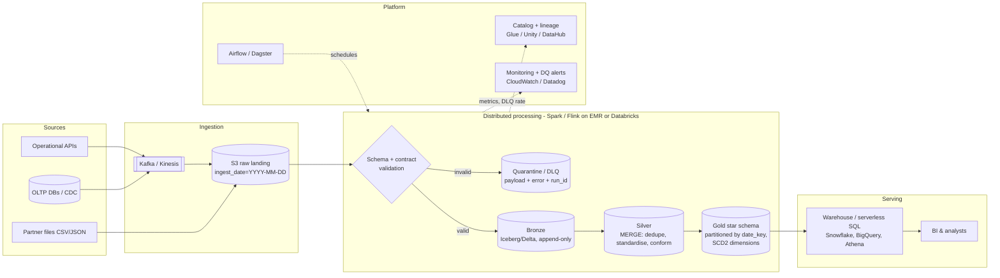

# Cloud Scaling Discussion: from a laptop to terabytes per day

The local stack (Python + Pydantic + DuckDB) keeps the same *logical* design when
volume grows; what changes is where each stage runs and how data is laid out.

| Local component | Terabyte-scale equivalent |
| --- | --- |
| `data/raw/*.csv, *.json` | **Cloud object storage** (S3 / GCS / ADLS) landing zone, partitioned by `source/ingest_date=YYYY-MM-DD/` |
| Python loop + Pydantic | **Distributed processing**: Spark / Databricks, Flink or Beam. Pydantic contracts can be kept for service-edge validation; at volume the same rules are expressed as schema + expectations (Great Expectations, Delta/DLT expectations, dbt tests) and applied per partition |
| `data/dlq/*.json` | DLQ as a **queue/topic or quarantine table** (SQS/Kafka DLQ topic, or a `quarantine/` prefix in the lake) with the payload, error and run id; alerting on DLQ rate |
| `warehouse.duckdb` Bronze/Silver | **Lakehouse tables** (Delta Lake / Apache Iceberg / Hudi) on object storage: ACID, schema evolution, time travel, cheap storage and compute separation |
| Gold star schema in DuckDB | **Scalable analytical warehouse** (Snowflake, BigQuery, Redshift, Databricks SQL) or Gold Iceberg/Delta tables queried by a serverless engine (Trino/Athena) |
| `sql/*.sql` | Same SQL, run as **dbt** models (versioned, tested, documented) |
| `python -m src.pipeline` | **Orchestrator** (Airflow / Dagster / Prefect / Step Functions) with retries, backfills and SLAs |

## Key design concepts

**Partitioning.** Partition fact data by event date (`date_key` / `transaction_date`), the
column nearly every query filters on, so a "current month" query touches ~30 partitions, not
the whole table. Avoid over-partitioning (small-file problem): partition by day, cluster /
Z-order within a partition on `entity_id` or `category`; compact small files regularly. Large
dimensions can be bucketed on the join key to reduce shuffle.

**Incremental processing.** The local pipeline is a full refresh (`CREATE OR REPLACE`), which
is fine for thousands of rows but not for TB/day. At scale:
* Bronze is **append-only**, keyed by `_ingested_at` / batch id, so any run can be replayed.
* Silver uses **MERGE / upsert** on business keys (`entity_id`, `transaction_id`) over only the
  new or changed partitions (watermarks, CDC, or file-arrival events). The `ROW_NUMBER()`
  de-duplication stays, but runs within the incoming batch plus the affected keys.
* Gold facts are appended per date partition; dimensions use **SCD Type 2** if history
  (e.g. an entity changing region) must be preserved. Late-arriving data is handled by
  reprocessing only the affected date partitions.

**Distributed validation and DLQ.** Validation is embarrassingly parallel (per record), so it
scales horizontally. Invalid rows are written to a quarantine table rather than failing the
job, with a circuit-breaker: if the invalid fraction exceeds a threshold, halt and alert,
because that usually means an upstream schema change rather than a few bad rows.

**Format and cost.** Land raw CSV/JSON once, then convert to columnar **Parquet** (compressed,
column pruning, predicate push-down). Separate storage from compute so each layer can scale
and be paid for independently; use auto-scaling / spot compute for batch jobs.

**Operational concerns.** Idempotent jobs; data contracts versioned in a registry; lineage and
catalog (Unity Catalog / Glue / DataHub); data-quality metrics and freshness monitoring; IAM
and encryption (PII such as `contact_email` masked or tokenised in Silver/Gold); CI/CD for
SQL and contracts.

## Reference architecture (AWS flavour; GCP/Azure equivalents in the table above)

### Local component -> production component

| This repository | At terabytes/day |
| --- | --- |
| `etl_batches` ledger (file hash, status) | Orchestrator state + table-format commit log (Iceberg snapshots / Delta log) |
| `ON CONFLICT DO NOTHING` merges in Silver/Gold | `MERGE INTO` on Iceberg/Delta, scoped to the affected date partitions |
| LOADED -> COMPLETE status with one transaction for Silver+Gold | Atomic table commits; failed jobs leave no partial snapshot and are simply retried |
| `dq_report` + circuit-breaker (`--max-invalid-ratio`) | Great Expectations / dbt tests, DLQ-rate alerts that halt the DAG |
| JSON logs with `run_id` | Same format shipped to CloudWatch/Datadog; plus metrics and traces |
| Late-arriving entity re-homes orphan transactions | Same logic, or deferred-dimension "inferred member" rows that are completed later |
